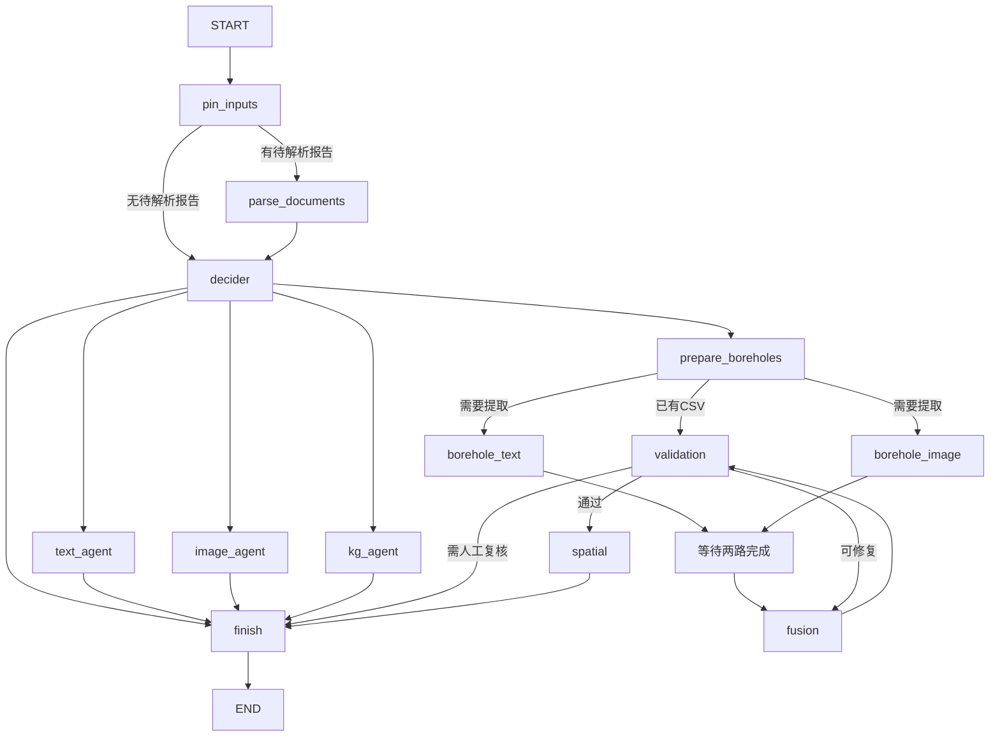
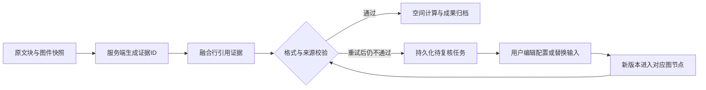
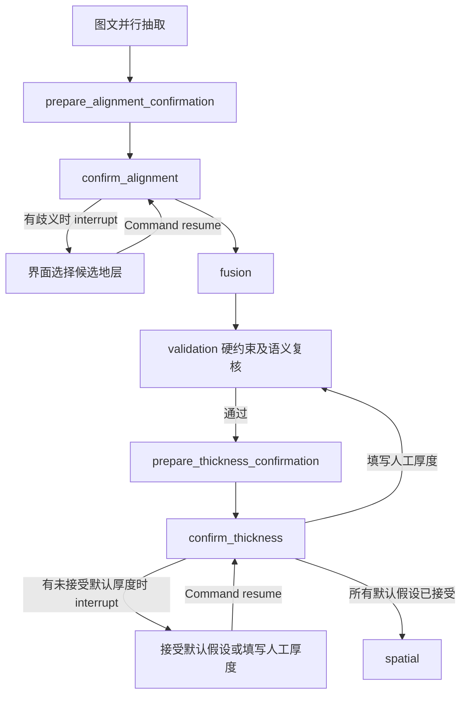

# 代码结构

主应用保留三个子包，其他功能各用一个模块。共21个Python文件，包含4个包初始化文件；
相比上次45个文件的结构，保留功能边界，但不再为几个辅助函数单独拆文件。

```text
app.py
agent_modeling/
├── agents/           # text.py、image.py、knowledge_graph.py
├── documents/        # parser.py、reports.py
├── storage/          # mysql.py、neo4j.py、workspace.py、state.py
├── config.py
├── errors.py
├── execution.py
├── models.py
├── orchestrator.py
├── fusion.py
├── boreholes.py
└── interface.py
```

## 三个子包

| 文件 | 职责 |
| --- | --- |
| `agents/text.py` | TextExtractionAgent：组织输入、查询资料、结构化抽取及合并结果 |
| `agents/image.py` | ImageAnalysisAgent：图例识别、图斑分割匹配及点击识别 |
| `agents/knowledge_graph.py` | KnowledgeGraphAgent：实体关系抽取、预览及可选存储 |
| `documents/parser.py` | 格式与参数、原生解析、MinerU适配及表格保留、缓存、文本视图和抽取单元 |
| `documents/reports.py` | ReportLibrary和create_text_tools：目录、检索、分段读取及词典工具 |
| `storage/mysql.py` | MySQLSessionStore：会话、消息和业务结果存取 |
| `storage/neo4j.py` | Neo4jGraphStore：图谱连接和写入 |
| `storage/workspace.py` | 上传文件、会话及运行目录、工作区清理 |
| `storage/state.py` | JSON序列化、Checkpoint类型白名单与历史模型路径兼容 |

## 单文件模块

| 文件 | 职责 |
| --- | --- |
| `config.py` | 路径、api_key.env加载及追踪开关 |
| `errors.py` | 异常、错误码和用户提示 |
| `execution.py` | 任务快照与事件存储、文件快照、进程级并发、协作式取消、调用用量和费用估算 |
| `models.py` | 地层、剖面、图例、区域和图谱Pydantic数据模型 |
| `orchestrator.py` | MasterAgent、MasterState、路由和自动钻孔流程编排 |
| `fusion.py` | 图文实体匹配、融合生成、JSON转CSV和配置校验修正 |
| `boreholes.py` | BoreholeGenerator：空间约束下的虚拟钻孔计算 |
| `interface.py` | Streamlit页面、上传、会话交互和展示 |

根目录app.py通过runpy执行interface模块，支持Streamlit每次重运行。
启动命令：`streamlit run app.py`。

## 合并关系

- 原core中的路径、配置和追踪合并到config.py。
- 原schemas三个模型文件合并到models.py。
- 原documents的十个解析辅助和后端文件合并到documents/parser.py。
- 原报告库和工具接口合并到documents/reports.py。
- 原fusion三个文件合并到fusion.py。
- 原序列化和Checkpoint类型配置合并到storage/state.py。

业务类和函数保留，主要改变模块位置、导入、资源定位和历史类型映射。
既有平铺版和上次agent_modeling.schemas.*布局的业务类型路径均保留兼容。

## 调用关系

```text
app.py → interface.py
  → documents/parser.py：解析报告
  → orchestrator.py：选择和组织任务
    → agents/：专业分析
      → documents/reports.py：查询证据
    → fusion.py：融合与校验
    → boreholes.py：空间计算
  → storage/：保存文件、会话和结果
```

## 主控图节点编排

`orchestrator.py` 将专业 Agent 注册为 LangGraph 节点。主控不再注册子 Agent 工具、
生成子 Agent 的 tool_calls 或通过 tool_executor 分发调用。
动态模式由路由模型输出经过 Pydantic 校验的 task_type，固定模式直接使用指定任务类型。
条件边只选择图中允许的路径；节点的输入参数直接读取当前 State。



- text_agent、image_agent、kg_agent 分别调用现有专业 Agent 的独立图。
  节点只传递所需输入，并将业务结果映射回 final_text_info、final_image_analysis、final_kg。
- borehole_text、borehole_image 复用相同的专业 Agent 节点实现，但使用独立节点名，
  使单独分析流程能够正常结束，钻孔流程能够用等待边汇合。缺少可选输入时，该分支记为 skipped。
- 图文对齐和融合在 fusion 节点完成；validation 节点使用确定性规则校验。
  校验失败会携带上一轮输出和错误返回 fusion，最多额外修复两次；关闭回溯时只生成一次。
- 用户上传的 CSV 直接校验，不进入生成或修复节点。无 SHP 时返回 CSV 和 PartialSuccess；
  有 SHP 且配置校验通过时，spatial 节点调用 BoreholeGenerator。
- 分支只更新各自的结果和置信度字段。日志、错误和监控指标使用 Reducer 合并，
  公共 next_step、final_response 由 finish 统一写入。分支失败会阻止后续融合和空间计算。
- pipeline 存储本轮文件路径、证据、融合行、CSV、校验记录及重试计数。成功后从最新
  Checkpoint 清空大字段；待复核任务保留中间状态。完整任务快照另存 tasks.sqlite。
- thread_id 为 session_id:task_id；新请求创建新任务，恢复请求沿用任务ID并递增版本。
- 文档解析、文本和图像处理、融合、校验、空间计算均通过后台图执行，界面可以发送取消请求。

文本 Agent 内部的检索报告、读取章节和查询词典工具仍由文本 Agent 自己注册和选择。
此次调整改变主控的调度方式，专业 Agent 的内部上下文和工具能力继续保留。

## 证据、复核和执行控制

models.py中的EvidenceRef、IssueRecord、ArtifactRecord、TaskRecord和CallEvent统一描述
证据、问题、成果版本、任务状态和调用记录；图中以普通字典传递，避免增加Checkpoint类型依赖。



证据校验检查引用存在性、字段值一致性、单位换算、地层归属、已确认的图文匹配及有证据的
上下覆关系。近似厚度、区间厚度或缺少明确关联的字段会保留为待复核问题。模型返回的
source_text不作为原始证据；图件证据保存源文件SHA256、图例ID和坐标。
图件证据的verified表示识别结果与图件来源已关联，不表示程序独立证明了OCR或地质结论正确。

融合输出为rows，每行含原有8个业务字段及source_refs、value_kinds。
source_refs保存字段对应的证据ID；value_kinds区分reported、image、default、derived等来源。
30米默认厚度明确标为default；用户直接修正的字段标为user，上传CSV的原始字段标为configuration。
与来源不符的字段不能仅靠修改来源标签通过检查。

界面的“任务记录与复核”支持修改配置、替换报告、重新提取文本、重新识别图件或重试当前阶段。
恢复读取服务端快照，校验会话和预期版本，再通过条件入口进入指定阶段；已完成的其他Agent
在定向文本/图件复核时无需重跑。修正原因、问题解决记录、每一版成果路径和校验和随任务保存。
人工编辑后先校验，仍有问题时继续复核；用户可显式选择“重新融合”。人工已确认字段形成约束，
后续模型调用必须保留其值和证据引用；只有新的用户修正可以替换这些约束。

持久化分工：

| 位置 | 内容 |
| --- | --- |
| runtime/checkpoints/langgraph.sqlite | 图执行检查点 |
| runtime/checkpoints/tasks.sqlite | 任务元数据、完整业务快照、逐次调用事件和取消标志 |
| runtime/sessions/.../任务ID/v版本/ | 源文件快照、融合审计、配置、完整结果及钻孔成果 |
| MySQL chat_history.result_state | 界面使用的业务结果、任务与证据、调用记录和汇总指标 |

调用接口：

```python
result = master.run(text=report_text, instruction="生成钻孔", session_id=session_id)
task_id = result["task_record"]["task_id"]
record = master.get_task(task_id, session_id=session_id)

result = master.resume(
    task_id,
    {"csv_content": corrected_csv, "reason": "已核对报告并修正厚度"},
    session_id=session_id,
    expected_version=record["version"],
)
# 执行期间，由界面或另一个线程调用：
master.cancel(task_id, session_id=session_id)
```

resume还支持rows，以及stage=text/image/parse_documents等定向恢复。
text可传修正后的完整文本，image_path可传替换图件，document_paths可传替换报告列表。
confirm_all=true表示用户明确将整行填写值作为人工确认来源；默认保留未改字段的原始引用。
待复核任务可由新建的主控实例读取并继续；此接口不实现多进程工作队列或崩溃运行任务的租约调度。

所有模型调用共用进程内信号量，文本与图谱线程池传递执行上下文；同一个专业Agent实例
避免被多个任务同时修改。并发配置位于api_key.env：

| 配置 | 默认值 | 作用域 |
| --- | --- | --- |
| APP_MAX_MODEL_CONCURRENCY | 4 | 全进程同时进行的模型请求 |
| APP_MAX_WORKERS | 4 | 同时执行的任务与工具调用上限，以及每个Agent线程池的工作线程上限 |
| APP_MAX_NODE_CONCURRENCY | 2 | 每次图执行的节点并发上限 |

取消标志写入数据库，并在等待执行许可、模型调用前后、分块、像素批处理和空间计算循环中检查。
第三方调用和单个本地计算步骤在返回前不能强制终止；取消生效后不启动后续业务步骤。
以上并发限制为单进程范围，多进程部署需要额外的共享限流与任务调度。

CallEvent为每次节点、模型和工具调用记录开始与结束事件，包含task_id、version、call_id、
parent_call_id、operation_id、时间、状态、用量和估算费用。模型传输重试逐次记录；节点摘要
仍显示最后一次状态，完整历史从事件表读取。累计流程用时以run事件计，包含解析与排队，
不包含用户复核等待；并行调用耗时之和可能大于流程用时。

APP_MODEL_PRICES_JSON可按模型名配置input_per_million、output_per_million及currency。
事件同时保存当次单价；用量或单价缺失时费用为null，汇总区分已计价金额和未知调用次数。
费用仅为模型Token估算，不包含外部解析服务、机器资源及供应商未返回的费用。
任务记录覆盖run/resume入口执行的链路，独立点击识别等无任务上下文的调用共用并发限制。

## 融合管线状态与两层校验

MasterState.pipeline是一次融合/钻孔任务的阶段工作数据，不是另一个Agent或全局变量。
shp/tif/csv/regions记录当前输入或输出路径；supplied_csv区分用户配置与自动生成配置；
rows保留8个业务字段及source_refs/value_kinds，csv_content保存对应CSV文本；sources保存
地层、剖面、图例；prompt是当前融合提示词缓存；attempt记录生成次数；issues/output_issues
记录业务校验与输出解析问题；trace/trace_path记录逐轮校验；manual_constraints/manual_review
保存人工约束与禁止自动重写的状态。evidence是MasterState的同级字段，不嵌套在pipeline中。

validation先执行格式、数值、单位、归属及证据硬约束，全部通过后执行LLM语义复核。
APP_SEMANTIC_REVIEW默认为true，APP_SEMANTIC_REVIEW_MODEL为空时复用主模型；设为false
明确退回仅硬约束模式。复核使用独立消息、温度0，不开放工具，只接收当前配置、已抽取来源、
证据及人工约束，不重新读取图片像素或完整原始文档。模型复核并非独立正确性证明。

复核协议为passed/repair/needs_review；repair每项必须引用已知证据，行号和字段亦由代码校验。
可修复矛盾沿validation→fusion反馈，仍受最多3次生成及人工约束保护；歧义、需人工判断、
无效复核输出、模型故障或超出20万字符资料上限均停止空间计算并进入现有任务复核流程，
不自动放行、不截断资料后宣称完整复核。取消仍沿统一取消机制传播。

pipeline.semantic_review和每轮trace保存复核状态、模型、说明、问题、输入指纹及耗时。
复核模型使用invoke_model，纳入统一并发、取消、逐次事件、Token及费用估算。
空间节点只复用配置、证据、来源、人工约束及复核版本/模型均未变化的通过结果；修改后或旧任务
从空间阶段恢复时会重新复核，失败则转为待人工复核。显式重试validation会再次调用复核模型。

目前界面的“任务记录与复核”支持配置修改、明确确认全部值、补充完整文本、替换图件、
重新融合或重试阶段；人工提交记录成为新版本。图例歧义、资料冲突和语义复核故障可在这里处理。
默认厚度与不确定的图例地层对应关系现使用LangGraph原生interrupt()确认，详见下节。
地图配准、DEM异常、随机扰动参数尚无独立的强制确认关卡，模型passed不能替代这些业务审批。

## 原生中断确认

独立文本抽取直接完成并展示地层和剖面结果，不因字段缺少直接原文证据进入人工复核。
证据不足仍保留为问题提示，不视为已经人工确认。仅融合流程因默认厚度、图例地层歧义及
融合校验问题等待人工确认；文本模型或文档解析的实际执行错误仍标记失败。



两个prepare节点准备问题和来源，确认节点不在interrupt前调用模型或写文件，防止恢复时重复
执行昂贵操作。暂停通过invoke返回__interrupt__，执行器提取并保存中断ID和payload，任务
保持awaiting_review，resume_stage=interrupt；不调用finish，不清理checkpoint，也不对
待恢复checkpoint做update_state。工作线程及执行许可随本次invoke返回释放。

界面在任务记录中显示默认厚度、图件和图例裁剪、候选地层的代号/评分/证据。厚度默认选中
接受当前建模假设，用户点击提交后才生效；地层对应可以留空，说明也可以留空。无合适候选时
可以改用补充文本、替换图件等阶段重跑。原生回复接口：

```python
master.resume(task_id, session_id=session_id, expected_version=record["version"], corrections={
    "reason": "接受乙组默认厚度作为本次建模假设",
    "confirmation_answers": [
        {"question_id": question_id, "action": "accept_default"},
        # 或 action=set_thickness, thickness=25.0
        # 图例问题用 action=select_formation, entity_id=候选实体ID
    ],
})
```

后端检查会话归属、版本、当前中断ID、问题全集、候选实体ID及有限正数厚度，再原子领取新
版本，使用相同thread_id调用graph.invoke(Command(resume=...))，从原中断节点继续。
当前使用LangGraph 1.0.7兼容的基础interrupt协议，Pydantic校验在应用侧完成，不依赖新版
response_schema。源资料或候选变化会改变确认键，旧确认不能直接用于新问题。
暂不确定的项目可用action=defer（不同时提交厚度或实体ID）；已确定项目先保存，剩余问题
继续通过原生interrupt等待，不作为错误，也不会带着未确定的地层对应进入空间计算。
原因字段reason可省略、留空或为null，服务端为审计记录补充操作说明，不冒充用户填写的意见。
界面在全部项目均未确定且说明为空时保持原待办，不创建无变化版本。替换报告留空则复用原文件。

接受30米假设保留value_kinds.default，并记录default_acceptances；用户填写厚度，即使
填写30米，也转为user证据和人工约束。确认历史随任务版本保存。配置/语义错误仍使用既有
阶段修正机制，两类恢复入口不能在一次提交中混用。

图例确认以共享该图例的图斑为一组，避免逐图斑重复确认。明确的自动匹配与人工选择一起
传给融合提示词和来源校验；空间模块消费legend_formation_mapping.json，按分区读取实际
层序编号。已移除按图例纵向排序分桶的猜测，也不再扫描旧版本选择最近的图斑文件；图斑
起始地层没有明确映射时不放行计算。图片范围到地理范围的线性映射仍是原有近似实现。

## 任务成果展示

完成消息展示实体、剖面或图谱节点/关系数量。文本结果面板默认展开，地层和剖面以平面业务
字段表格直接展示，不依赖source_text存在，也不必先打开原文交互图。空结果明确显示数量0，
缺失字段保留空值，不伪造默认业务值；完整实体、剖面及证据可下载为JSON。
融合流程暂停待确认时，也展示已经完成的文本/图件阶段结果。图例表默认展开，知识图谱展示
节点和关系；仅生成配置的PartialSuccess展示配置表及CSV下载，不再显示为数据生成失败。

## 验证与备份

运行`python -m unittest discover -s tests -v`执行离线测试。
覆盖文档解析、文本工具循环、主控条件路由、并行汇合、校验回路、内部导入、路径和历史类型兼容。
编排测试使用真实 LangGraph 和 SQLite Checkpoint，专业 Agent 和外部模型使用离线替身。
缺少 LangGraph/SQLite 依赖时，图执行测试会显示 skipped；安装项目依赖后运行可完整验证。
这些测试不代表真实 OCR、LLM、Neo4j 或地理计算服务联调已完成。

重构前的源码备份位于runtime/layout_simplification_20261024/backup/；切换前原目录在
同级pre_activation/。这些文件不是运行源码，也不进入版本管理。
