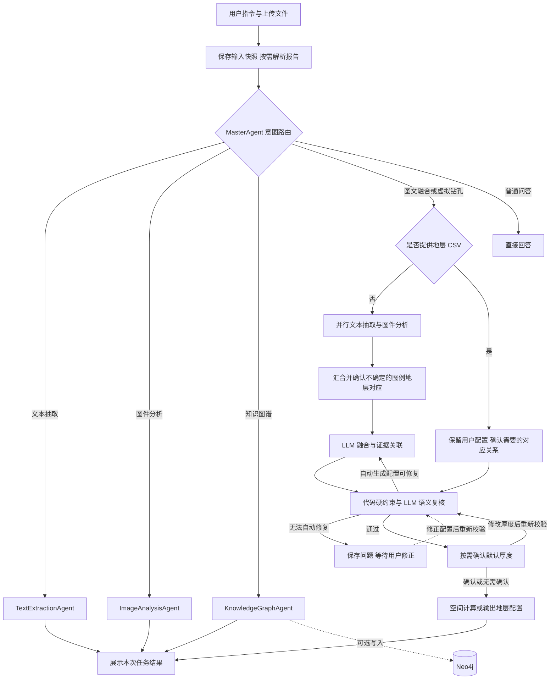

# 多智能体多模态虚拟钻孔生成系统

面向三维地质建模中真实钻孔获取成本高、空间覆盖有限的问题，本项目构建了一套多智能体虚拟钻孔数据生成原型。系统能够解析地质报告和地质图件，融合地层、岩性、年代、图例、地质边界及 DEM 高程信息，在空间与地层规则约束下生成标准化虚拟钻孔点云，并提供知识图谱构建能力。

> 项目当前定位为科研原型。生成结果用于三维地质建模研究和方法验证，不能替代真实钻探、测绘或工程勘察结论。

## 功能概览

- 地质文本抽取：从非结构化报告中提取地层、年代、岩性、厚度、剖面及上下覆关系。
- 地质图件解析：检测图例与地图区域，识别地层符号，并按照颜色和纹理匹配图例与地质区域。
- 多模态融合：并行处理文本和图像信息，通过大模型完成地层实体对齐，生成标准地层配置。
- 虚拟钻孔生成：结合 SHP 边界、DEM 高程、地层厚度、空间扰动和尖灭规则生成钻孔点云。
- 知识图谱构建：抽取地层、年代、岩性、构造和空间分布关系，可选写入 Neo4j。
- 文档接入：普通文本使用 Python 原生解析，Word/PDF 的正文、结构与表格统一使用 MinerU，不再依赖 Docling。
- 交互与持久化：通过 Streamlit 展示抽取实体、剖面、图件和生成结果；融合任务支持人工确认、版本化修正与 Checkpoint 恢复，MySQL 保存会话记录。

## 技术体系

- Agent 编排：LangChain、LangGraph
- 文档解析：Python 原生读取、MinerU
- 大模型：Qwen、Qwen-VL、DeepSeek（通过兼容的模型服务调用）
- 视觉处理：PyTorch、YOLO、OpenCV、PEACE
- 地理计算：GeoPandas、Rasterio、PyProj、Shapely
- 虚拟钻孔：NumPy、Pandas、GeoPandas、Rasterio
- 数据与界面：MySQL、Neo4j、NetworkX、Streamlit

## 系统架构



### Agent 通信方式

当前系统采用显式图节点编排：`MasterAgent` 的路由节点输出经过 Pydantic 校验的任务类型，条件边选择文本、图像、知识图谱节点或钻孔流程。各节点直接调用专业 Agent 的独立图，通过共享 State 交换业务结果；主控不再将子 Agent 注册为 LangChain Tool。`messages` 使用 `add_messages` Reducer，执行日志和错误追加合并，节点监控按节点名合并；图通过 SQLite `SqliteSaver` 持久化检查点，以`会话ID:任务ID`作为`thread_id`。各 Agent 运行在同一进程内。

自动钻孔任务通过图的并行分支执行文本抽取和图像解析，等待两路完成后进入对齐与融合流程。校验节点先执行代码硬约束，再执行默认开启的 LLM 语义复核；允许自动修复时通过条件边返回融合节点，最多额外修复两次，无法修复的问题保存后等待用户处理。用户提供的 CSV 直接校验，不由模型重写。文本 Agent 内部可自主选择报告检索、章节读取和地层词典工具。每轮调用前，系统将当前 MySQL 会话最近的用户与助手消息转换为 LangChain 消息，作为路由上下文；专业 Agent 只接收映射后的任务输入，不自动共享彼此的完整工具对话。节点和状态流转说明见 [代码结构](docs/code-structure.md)。

每个任务先保存输入文件快照，再按需解析报告。融合字段引用原文块、图例或用户修正证据，程序检查引用、数值、单位、地层归属及明确的层序关系。融合任务的未解决问题连同中间结果保存为待复核任务；界面的“任务记录与复核”支持编辑配置、替换报告或图件、定向重试，沿用任务 ID 并生成新版本。独立文本抽取直接完成并展示结果，缺少直接原文证据仅作提示，不要求人工确认。

融合流程对不确定的图例与地层对应关系、缺少厚度而采用默认 30 米的情况使用 LangGraph 原生 `interrupt()`。用户可选择候选地层、接受默认值、修改厚度或暂不处理；备注可留空。提交后通过同一图线程的 `Command(resume=...)` 继续，仍有未解决项时保持暂停。接受默认厚度仍标记为默认值，手动填写的厚度保存为人工值及其证据。

任务在后台执行，界面“停止生成”发送实际取消请求；取消在调用边界及计算循环中生效。模型请求使用全进程统一并发上限，分块线程继承任务上下文。各次节点、模型和工具调用的开始、结束、父调用、Token和估算费用写入事件表；缺少用量或单价时费用显示未知。并发和单价配置见config/api_key.env.example。

侧栏的“清空并重新开始”会同时删除当前会话的 LangGraph Checkpoint、MySQL 消息历史、上传组件状态和图件交互缓存，并将会话标题恢复为“新对话”；会话记录本身会保留，方便直接开始新的分析任务。

### 运行监控与异常处理

LangSmith 云端追踪默认关闭，本地节点监控与 MySQL 记录不受影响。如需启用，请配置 `APP_ENABLE_LANGSMITH=true` 和 `LANGSMITH_API_KEY` 后重启应用；旧的 `LANGSMITH_TRACING` / `LANGCHAIN_TRACING_V2` 开关由该显式配置统一控制。网络不可用或云端 Trace 配额耗尽时，可关闭该选项避免重复上报失败。

Checkpoint 使用精确的业务模型类型白名单，支持严格 MsgPack 反序列化。历史结果保存默认保留全部图例，不再截断为 50 项；之前已截断或损坏的历史数据需重新执行解析恢复。视觉模型返回的空文本及无效置信度会在入模前标准化，避免交互区域识别出现空值校验错误。

每轮 LangGraph 执行会在状态中记录真实的节点运行指标，包括节点状态、耗时、实际模型、重试次数和错误码；路由决策、结构化错误以及文本、图像、融合和整体置信度也会随助手消息写入 MySQL，刷新页面后仍可在“Agent 运行监控”中查看。置信度来自专业 Agent 的结构化输出聚合；当模型未返回置信度时，该字段保持为空，不使用随机数或固定演示值。

项目通过 `agent_modeling/errors.py` 统一划分配置、数据库、模型调用、文件校验、地理计算和 Agent 执行异常。服务日志保留异常上下文与完整堆栈，前端和会话历史只展示稳定的中文提示与错误码，避免把密钥、路径、SQL 或第三方接口细节直接暴露给用户。可降级能力（例如 YOLO、PEACE 或 Neo4j）失败时会记录日志并进入原有回退流程，不中断可继续完成的主任务。

## 处理流程

### 1. 文本信息抽取

上传报告先转换为带标题、内容块和来源位置的统一文档，再交给语言模型抽取。TXT、Markdown、JSON 和 HTML 使用 Python 原生解析，Word/PDF 只使用 MinerU；表格直接保留 MinerU 的输出，不再运行 Docling 或额外的 LibreOffice 转换。解析器不是抽取模型，解析后的正文仍会实际发送给 LLM。

结构化文档按内容块组织抽取单元，目标约 6000 字符，表格保持完整；直接传入纯文本时使用 6000 字符、300 字符重叠的切分。各分块并发执行，有独立消息列表，可检索同一份本次报告库。最终按照 Pydantic Schema 输出：

- 地层名称与代号
- 主、次地质年代及代号
- 分布区域与岩石特征
- 剖面位置、厚度和岩石组合
- 上覆与下伏地层
- 条目置信度

实体字段不要求完整，缺失值保留为 `null`，不按置信度过滤实体。结构化输出解析异常时可回退到明确的 JSON 数据模板重试；首次得到空结果时再核对一次。返回 Schema 定义、缺少业务结果键或完全没有业务字段的实体会判为异常，不能直接当作空抽取成功。

前端展示抽取数量、地层实体表、剖面表和含证据信息的 JSON 下载。部分字段找不到直接原文证据时保留提示，任务正常完成，不进入人工确认。用户上传的图片在聊天区域右侧显示。

### 2. 地质图件解析

图像 Agent 使用 PEACE/YOLO 检测图例和地图主体，调用视觉语言模型识别图例文字与符号，再通过颜色距离和纹理直方图完成图例—区域匹配。解析结果包括图例信息、区域轮廓、匹配置信度和可视化图件。

### 3. 图文融合

系统并行获取文本地层实体和图像图例序列，随后由大模型完成名称、代号、年代与层序对齐，输出八列地层配置：

```text
part_code, formation, formation_code, formation_age_1,
formation_age_code_1, formation_age_2, formation_age_code_2, 厚度
```

其中 `formation_code` 是从 1 开始递增的建模层序编号，区别于文本抽取中的原始地层代号；`厚度` 按米解释。字段证据、报告值/默认值/人工值分类和校验记录保存于任务状态及审计文件，CSV 保持八列格式。

### 4. 虚拟钻孔生成

虚拟下钻模块将 SHP 地质边界栅格化，采样 DEM 获取地表高程，并结合地层配置和图像区域约束生成三维点。输出字段为：

```text
x, y, z, formation_code, value, surface, borehole_id
```

其中 `x/y/z` 为三维坐标，`formation_code` 和 `surface` 表示地层，`value` 表示地质分区编号，`borehole_id` 表示钻孔编号。

## 项目结构

```text
agent_modeling/
|-- app.py                   # Streamlit 启动入口
|-- agent_modeling/
|   |-- agents/              # text.py、image.py、knowledge_graph.py
|   |-- documents/           # parser.py：解析与分块；reports.py：资料库与工具
|   |-- storage/             # MySQL、Neo4j、工作区与状态保存
|   |-- config.py            # 路径、配置和追踪
|   |-- errors.py            # 异常与错误码
|   |-- execution.py         # 后台任务、调用事件、并发和取消控制
|   |-- models.py            # 统一业务数据模型
|   |-- orchestrator.py      # 主控路由与任务编排
|   |-- fusion.py            # 图文匹配、融合生成和校验
|   |-- boreholes.py         # 虚拟钻孔空间计算
|   `-- interface.py         # 页面、上传与展示
|-- config/                  # 配置模板
|-- database/                # SQL 表结构
|-- requirements/            # 可选依赖
|-- tests/                   # 离线测试
|-- docs/                    # 使用说明
|-- PEACE/                   # 第三方检测器与本地模型
`-- runtime/                 # 会话、结果、缓存和 Checkpoint
```

项目保留主应用及其运行依赖，已移除独立实验脚本、论文、截图和未被调用的 PEACE Copilot、地震、人口、土地覆盖与知识库模块。Ultralytics 内部存在交叉导入和模型加载依赖，因此保留完整依赖源码。许可证及第三方声明一并保留。

本地已有的 `api_key.env`、`runtime/` 会话数据和 `PEACE/models/` 模型权重用于实际运行，不纳入版本管理。`output/`、`temp/` 等输出目录会由程序按需自动创建。

## 环境准备

建议在独立环境中安装依赖。GDAL、GeoPandas、Rasterio、VTK 和 GemPy 含本地二进制依赖，需要保证 Python 版本与安装包兼容。`requirements.txt` 保留了当前环境的固定版本，其中 PyTorch 使用 `+cpu` 版本；首次安装时可能需要匹配的 CPU 软件源，不能保证所有平台直接安装成功。

```powershell
python -m venv .venv
.venv\Scripts\Activate.ps1
python -m pip install --upgrade pip
pip install -r requirements.txt
pip install -r requirements/checkpoint.txt
# 需要 Word/PDF 时再安装解析 SDK 并配置模型：
pip install -r requirements/documents.txt
```

如果直接通过 `pip` 安装地理计算依赖失败，可以先使用 Conda 创建包含 GDAL、GeoPandas 和 Rasterio 的环境，再安装其余依赖。

图件检测需要自行准备 PEACE 模型权重，并分别放置到：

```text
PEACE/models/det_component/weights/best.pt
PEACE/models/det_legend/weights/best.pt
```

## 配置服务

复制配置模板：

```powershell
Copy-Item config/api_key.env.example api_key.env
```

需要配置以下环境变量：

| 配置项 | 是否必需 | 用途 |
|---|---:|---|
| `DASHSCOPE_API_KEY` | 是 | Qwen/Qwen-VL 等模型调用 |
| `DB_HOST`、`DB_PORT` | 是 | MySQL 地址与端口 |
| `DB_USER`、`DB_PASSWORD`、`DB_NAME` | 是 | MySQL 认证与数据库名称 |
| `NEO4J_URI`、`NEO4J_USER`、`NEO4J_PASSWORD` | 否 | 知识图谱持久化 |
| `DOCUMENT_MINERU_TIER` | Word/PDF 解析时 | MinerU 档位，默认 `standard` |
| `DOCUMENT_MINERU_API_URL`、`MINERU_API_KEY` | 否 | 自建 MinerU 服务地址和可选密钥；地址为空时使用本地 SDK |
| `TEXT_AGENT_DICTIONARY_PATH` | 否 | 文本 Agent 查询的 UTF-8 JSON 地层词典 |
| `APP_SEMANTIC_REVIEW` | 否 | 是否执行融合语义复核，默认 `true`；代码硬约束始终执行 |
| `APP_SEMANTIC_REVIEW_MODEL` | 否 | 单独指定语义复核模型，留空沿用主模型 |
| `APP_MAX_MODEL_CONCURRENCY` | 否 | 进程内模型调用并发上限，默认 `4` |
| `APP_MAX_WORKERS`、`APP_MAX_NODE_CONCURRENCY` | 否 | 后台任务/分块工作线程上限与单次图执行的节点并发上限，默认分别为 `4`、`2` |
| `APP_MODEL_PRICES_JSON` | 否 | 按模型配置每百万输入/输出 Token 单价，用于估算费用 |

MinerU 的额外依赖在 `requirements/documents.txt`。本地模式还需准备对应模型和运行环境；安装 SDK 并不表示解析模型已就绪。配置变化后重启应用，完整配置见 [配置模板](config/api_key.env.example) 和 [文档解析说明](docs/document-ingestion.md)。

`database/schema.sql` 只负责创建数据表。请先创建与 `DB_NAME` 一致的数据库，再导入表结构。默认数据库名为 `agent_chat_db`：

```powershell
mysql -u root -p -e "CREATE DATABASE IF NOT EXISTS agent_chat_db CHARACTER SET utf8mb4;"
cmd /c "mysql -u root -p agent_chat_db < database/schema.sql"
```

不要提交包含真实密钥或密码的 `api_key.env`。如果该文件曾被提交到 Git 或推送到远程仓库，仅从当前版本删除还不够，必须同时轮换其中的 API Key、数据库密码，并按团队协作情况决定是否清理 Git 历史。

## 启动应用

```powershell
streamlit run app.py
```

浏览器打开 Streamlit 输出的本地地址后，可以在侧栏选择模型、管理历史会话并上传任务文件。

### 支持的输入

| 数据类型 | 扩展名 | 说明 |
|---|---|---|
| 地质报告 | `.txt`、`.md`、`.markdown`、`.json`、`.html`、`.htm`、`.doc`、`.docx`、`.pdf` | 普通文本使用原生解析，Word/PDF 的正文、结构和表格统一使用 MinerU |
| 地质图件 | `.jpg`、`.png` | 默认使用第一张图片执行图像任务 |
| 地层配置 | `.csv` | 可跳过自动图文融合，直接用于虚拟下钻 |
| 地质边界 | `.shp`、`.shx`、`.dbf`、`.prj`、`.cpg` | 辅助文件应与 SHP 同名并放在同一目录 |
| 高程模型 | `.tif`、`.tiff` | 用于采样钻孔口高程 |

### 输入约束

- 当前虚拟下钻实现要求 SHP 属性表包含 `Id` 字段。
- 当前空间计算按 SHP 坐标为 WGS84 经纬度处理；其他坐标系应先转换或扩展 CRS 处理逻辑。
- 自动生成钻孔至少需要 SHP 和地层配置 CSV；DEM 缺失时会使用默认高程。
- 图像轮廓到地理空间的映射目前依据图像范围和 SHP 包围盒进行线性转换，不等同于严格的地理配准。

### 输出与状态保存

前端任务默认使用以下目录；直接调用 Python API 并指定 `workspace_dir` 时，运行目录以调用方配置为准。

| 路径 | 内容 |
| --- | --- |
| `runtime/sessions/<session_id>/uploads/<batch_id>/` | 当前会话上传的数据 |
| `runtime/sessions/<session_id>/documents/<cache_key>/` | 会话内统一文档 JSON 与 MinerU 解析产物 |
| `runtime/sessions/<session_id>/runs/<request_id>/<task_id>/v<version>/` | 当前任务版本的输入快照、结果及审计产物 |
| `runtime/checkpoints/langgraph.sqlite` | LangGraph 状态、原生中断和恢复位置 |
| `runtime/checkpoints/tasks.sqlite` | 任务索引、版本、问题、业务快照、逐次调用事件及取消标志 |

任务版本目录按执行阶段生成 `task_result.json`、`auto_generated_formation.csv`、
`fusion_alignment_audit.json`、`fusion_validation_trace.json`、`legend_formation_mapping.json`、
`virtual_boreholes_points.csv` 和 `image_analysis/`，不保证每种任务都有全部文件。
人工修正生成新版本，已有版本产物保留。页面提供地层配置、钻孔数据和阶段抽取结果的下载入口。

## 实现边界

- 主应用中的 `BoreholeGenerator` 当前负责虚拟钻孔点云生成，并未直接执行 GemPy 隐式模型求解。
- 当前项目不包含独立 GemPy 建模与定量验证实验脚本。
- Agent 编排采用一次意图路由、显式图节点及有限的融合修复循环，尚未实现持续规划和动态重新分派的 Supervisor。
- LangGraph Checkpoint 使用本地 SQLite 持久化，可在单机应用重启后恢复；多实例部署时应迁移到 PostgreSQL 等共享 Checkpointer。
- MySQL 保存会话和分析结果；Neo4j 不可用时，知识图谱仍可在内存中生成和展示。
- 模型输出、图像匹配和规则生成均存在不确定性，重要结果应结合专家审查和真实数据验证。
- 语义复核基于已抽取结果与证据库，不会自动重新阅读全部文档、图像或调度文本 Agent 补抽；不确定时可进入融合复核流程。
- 条目和整体置信度属于模型自评与工程聚合，尚未经实验校准，不能直接当作正确概率。
- 后台线程池和并发控制属于单进程运行机制；运行中的模型请求不能保证立即取消，也不提供分布式任务队列能力。

## 安全与版本管理

- `api_key.env`、运行缓存和生成目录已列入 `.gitignore`。
- 如果敏感配置曾经提交到 Git，仅添加忽略规则不能清除历史记录，应及时轮换凭据并清理仓库历史。
- PEACE 模型权重、实验数据和论文图件不进入源码仓库，应通过独立模型或数据存储分发。

## 开发与验证

```powershell
python -m unittest discover -s tests -v
```

请在安装了 LangGraph 和 SQLite Checkpointer 的应用环境运行，以覆盖图执行、并行汇合、
原生中断与恢复测试。模型调用、MinerU 和视觉服务主要使用替身验证协议与失败处理；
这些测试不代表真实 OCR、表格恢复和地质抽取准确率，实际部署仍需使用真实报告及图件联调。

详细包职责与旧文件迁移关系见 [代码结构说明](docs/code-structure.md)；文档解析配置见 [文档解析说明](docs/document-ingestion.md)。
